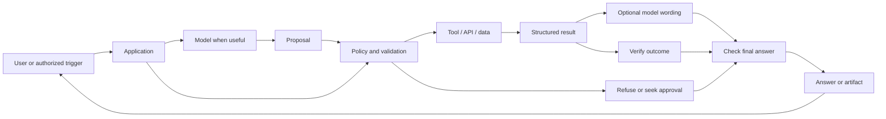
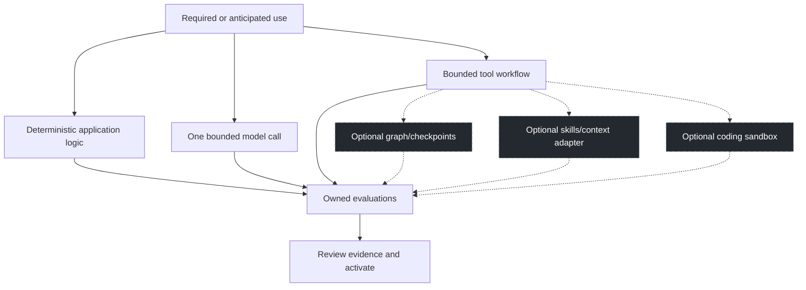
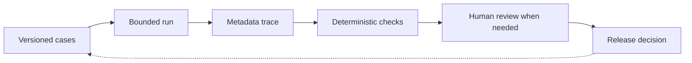

# Agent architecture and implementation options

Updated 10-15-2026. These editable Mermaid diagrams explain the skill's design guidance. This repository is a skill and reference collection; the diagrams do not claim that it supplies an executable control plane. The [dated architecture reference](architecture-reference/2026-10-03/README.md) remains historical evidence.

## End-to-end boundary

The application enforces authority; models propose actions and may explain results. Returned text is data. Evidence must establish what actually happened. A successful tool call does not prove that the final answer included its result, and a fluent answer does not prove a successful effect.

## Choose the smallest useful option

Dashed nodes are optional design choices, not installed features. A concrete future use can justify a bounded implementation before a present failure. Activation still depends on data, cost, permissions, compatibility, and acceptance evidence.

| Option | Useful comparison | Acceptance evidence |
|---|---|---|
| Native application loop | Existing host code and tools | Correct output, validation, bounded calls, explicit failures |
| LangGraph | Durable multi-step state | Checkpoint provenance, interrupts, no unauthorized replay |
| Deep Agents skills/context | Progressive context and reusable instructions | Negative activation, provenance, source/correction fidelity |
| Deep Agents Code / Open SWE | Isolated coding workflows | Repository boundaries, tests, review, no authority from retrieved text |
| Local tracing, later OTLP/LangSmith | Observable call/result/answer chain | Content policy, retention, deduplicated usage, failure isolation |
| OpenAI / Anthropic / xAI / Jev adapter | Provider-specific capabilities | Version identity, raw semantics, abstention, permission and cost controls |
| NVIDIA toolkit | Additional observability/safety integration | Concrete host fit and comparative acceptance evidence |
| OpenWiki-style workflow | Documentation grounded in repository sources | Revision/file citations and reviewed drift |

## Evidence loop

JARVIS engineering Steps 2 and 3 are local implementation work, not a skill release or proof of this repository's runtime behavior. See the [JARVIS status](https://github.com/sba311paw-coder/Private-Jarvis/blob/main/docs/current/TRACING-STATUS.md). Official resources, learning phases, and implementation order remain in [engineering resources](ENGINEERING-RESOURCES.md). Historical evaluation scores and skill version 0.1.2 are unchanged.
